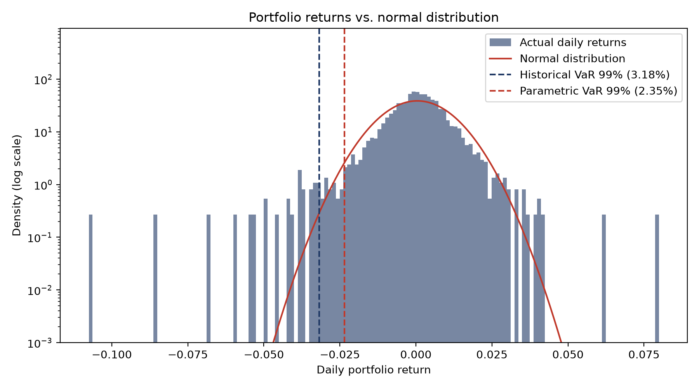
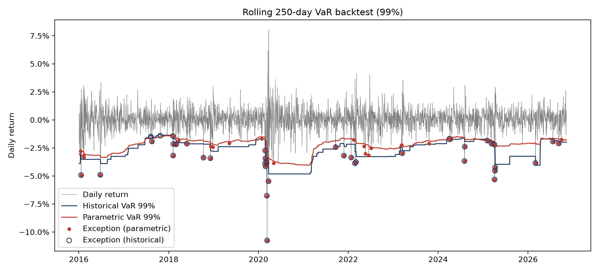
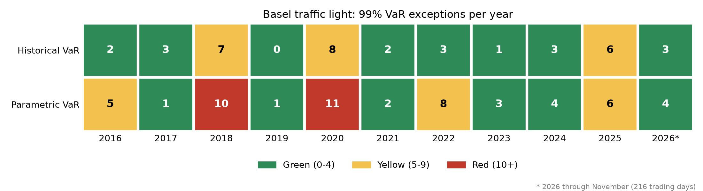

# Value at Risk and Expected Shortfall with Backtesting

Four Value at Risk (VaR) models for a Swiss equity portfolio, compared in a rolling out-of-sample backtest with the Kupiec test and the Basel traffic light.

## Key findings

- Daily portfolio returns have strong **fat tails** (excess kurtosis 10.2). The worst day (-10.8%) is about 10.5 standard deviations from the mean, practically impossible under a normal distribution.
- Models that assume normality are **rejected** by the Kupiec test: the parametric VaR has twice the expected number of exceptions.
- **EWMA volatility alone makes things worse** (61 exceptions): it reacts faster to crises but still assumes normal tails, and its VaR falls too low in calm periods.
- **Filtered historical simulation (FHS)**, which combines EWMA volatility with empirical tails, performs best: it passes the Kupiec test, has no red year and the mildest worst year.

## Data and portfolio

- Equal-weighted portfolio of four SMI stocks: Nestlé (NESN.SW), Novartis (NOVN.SW), UBS (UBSG.SW), Zurich Insurance (ZURN.SW)
- Daily adjusted closing prices from yfinance, 1 Jan 2015 to 10 Nov 2026
- Simple daily returns, portfolio rebalanced to equal weights every day
- 1-day horizon, 99% confidence level

## Methods

**Value at Risk** is the loss that is exceeded on only 1% of days; **Expected Shortfall** is the average loss on those days:

```math
\text{VaR}_{99\%} = -q_{1\%}(r), \qquad \text{ES}_{99\%} = -\mathbb{E}\left[r \mid r \le q_{1\%}\right]
```

1. **Historical simulation:** the empirical 1% quantile of the last 250 returns.
2. **Parametric (normal):** $`\text{VaR} = -(\mu + z_{0.01} \sigma)`$ with $`z_{0.01} \approx -2.326`$, using the mean and standard deviation of the last 250 returns.
3. **EWMA (RiskMetrics):** volatility that weights recent days more, with $`\lambda = 0.94`$ (half-life of about 11 trading days), and $`\text{VaR}_t = -z_{0.01} \sigma_t`$:

```math
\sigma_t^2 = \lambda \sigma_{t-1}^2 + (1-\lambda) r_{t-1}^2
```

4. **Filtered historical simulation (FHS):** returns are standardized by their EWMA volatility, $`u_t = r_t / \sigma_t`$. The VaR is the current volatility times the empirical 1% quantile of the last 250 standardized returns:

```math
\text{VaR}_t = -\sigma_t \cdot q_{1\%}(u_{t-250}, \dots, u_{t-1})
```

All models use only information available before day $`t`$ (no look-ahead bias).

## Results

### Fat tails

| Full sample | Historical | Parametric (normal) |
|---|---|---|
| VaR 99% | 3.18% | 2.35% |
| ES 99% | 4.48% | 2.70% |

The historical ES is 66% higher than the normal ES, compared with 35% for the VaR: the further into the tail, the larger the gap. Even after removing volatility clustering, the 1% quantile of standardized returns averages -2.93 instead of the normal -2.33.



### Rolling backtest

Each day's VaR is estimated from the previous 250 trading days and compared with the next day's return (2,730 backtest days, 27.3 exceptions expected).



### Kupiec test

The Kupiec proportion-of-failures test checks whether the number of exceptions $`x`$ in $`n`$ days is consistent with the target rate $`p = 1\%`$:

```math
LR = -2\ln\left[\frac{(1-p)^{n-x} p^{x}}{(1-\hat p)^{n-x} \hat p^{x}}\right] \sim \chi^2_1, \qquad \hat p = x/n
```

| Model | Exceptions | Rate | LR | p-value | Result (5%) |
|---|---|---|---|---|---|
| Historical | 38 | 1.39% | 3.78 | 0.052 | not rejected |
| Parametric | 55 | 2.01% | 21.93 | < 0.001 | rejected |
| EWMA | 61 | 2.23% | 31.11 | < 0.001 | rejected |
| FHS | 38 | 1.39% | 3.78 | 0.052 | not rejected |

### Basel traffic light

Exceptions per calendar year (green 0 to 4, yellow 5 to 9, red 10 or more).



Historical and FHS have the same number of exceptions in total, but FHS spreads them more evenly: its worst year has 6 exceptions instead of 8, and 2018 drops from yellow to green. The parametric model is red in 2018 and 2020, EWMA in 2020.

## Limitations

- Four stocks and equal weights only; results depend on this portfolio and period.
- One window length (250 days) and one decay factor ($\lambda = 0.94$), not optimized.
- The Kupiec test only counts exceptions. It does not test whether they cluster in time.
- Expected Shortfall is estimated but not backtested.

## Possible extensions

- Christoffersen test for the independence of exceptions
- Expected Shortfall backtesting at 97.5%, the Basel FRTB standard
- Student-t or GARCH models as alternatives to EWMA with normal tails

## How to run

```bash
git clone https://github.com/rachellliz/value-at-risk-backtest.git
cd value-at-risk-backtest
python -m venv .venv
source .venv/bin/activate
pip install -r requirements.txt
jupyter notebook var_backtest.ipynb
```
